

  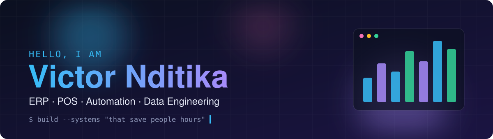

  
  
  

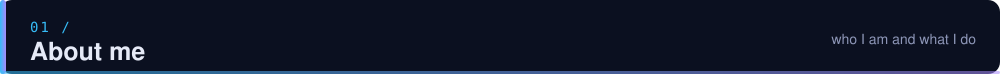

I build business systems that remove manual work. Most of what I do sits between an ERP, the people who use it, and the data that comes out of it: point-of-sale tills that reconcile themselves, reports that arrive on WhatsApp before the team is at their desks, and internal apps that give each role exactly the numbers it needs.

- **Odoo and POS:** custom modules, kiosk tills, bank and M-Pesa reconciliation
- **Automation:** n8n pipelines, web-UI data extraction, scheduled Excel reporting, self-healing monitors
- **Data and apps:** Postgres, SQL views, role-based Next.js dashboards
- **AI:** document OCR, fuzzy matching, LLM-assisted data cleaning, agents that triage failures
- **On the side:** trading research tooling (charting, MT5, Pine Script)

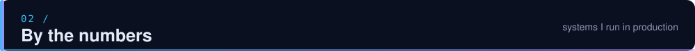

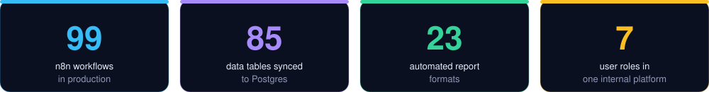

<table>
  <tr>
    <td>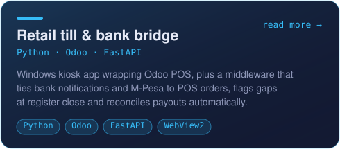</td>
    <td>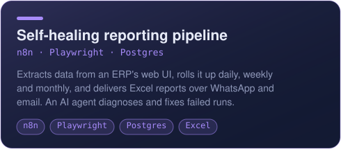</td>
  </tr>
  <tr>
    <td>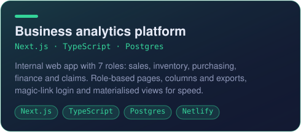</td>
    <td>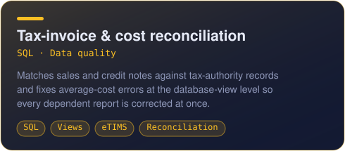</td>
  </tr>
  <tr>
    <td>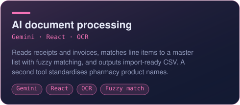</td>
    <td>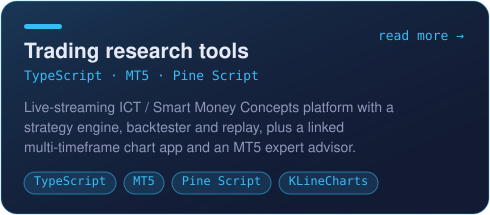</td>
  </tr>
  <tr>
    <td>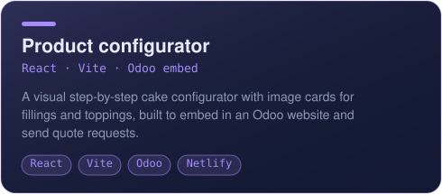</td>
    <td>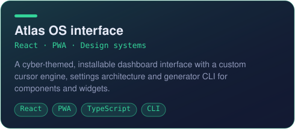</td>
  </tr>
</table>

> Most of this work is for private clients, so the code lives in private repositories. Happy to walk through any of it in a call.

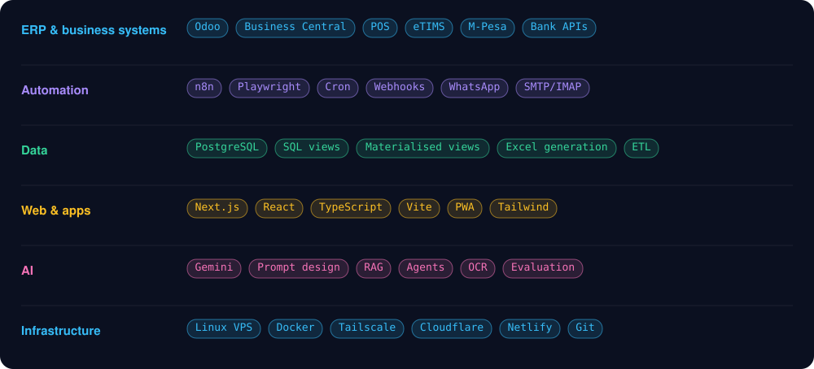

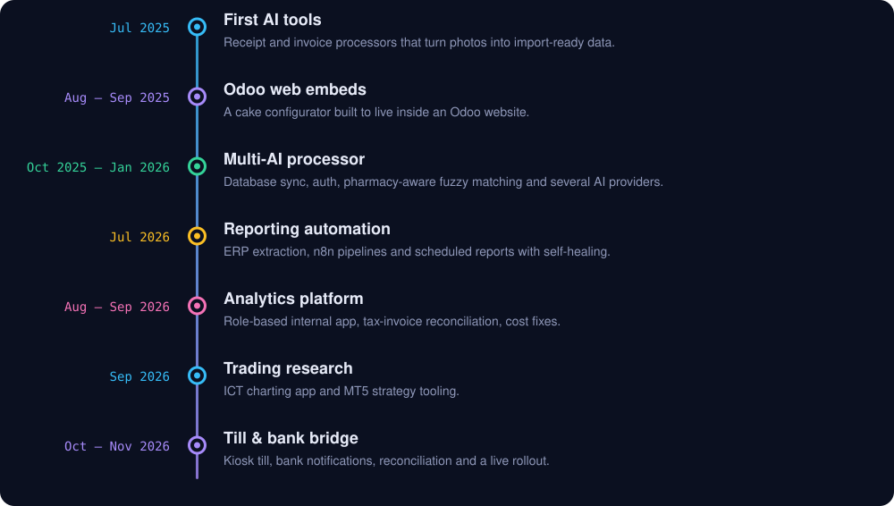

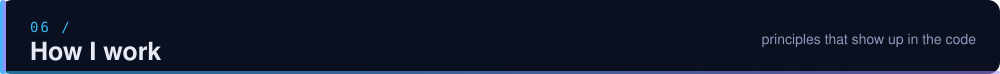

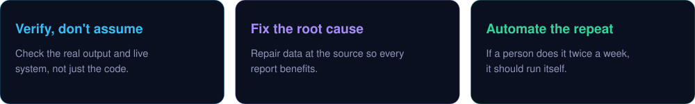

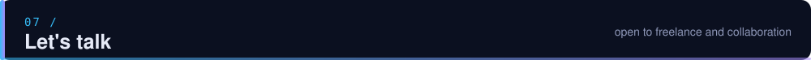

  
  

  

